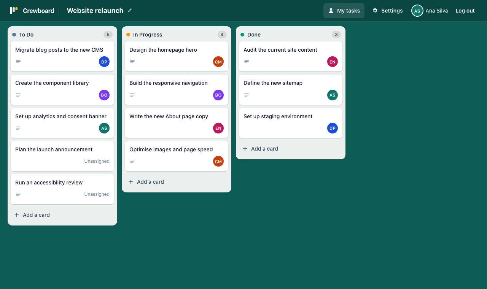
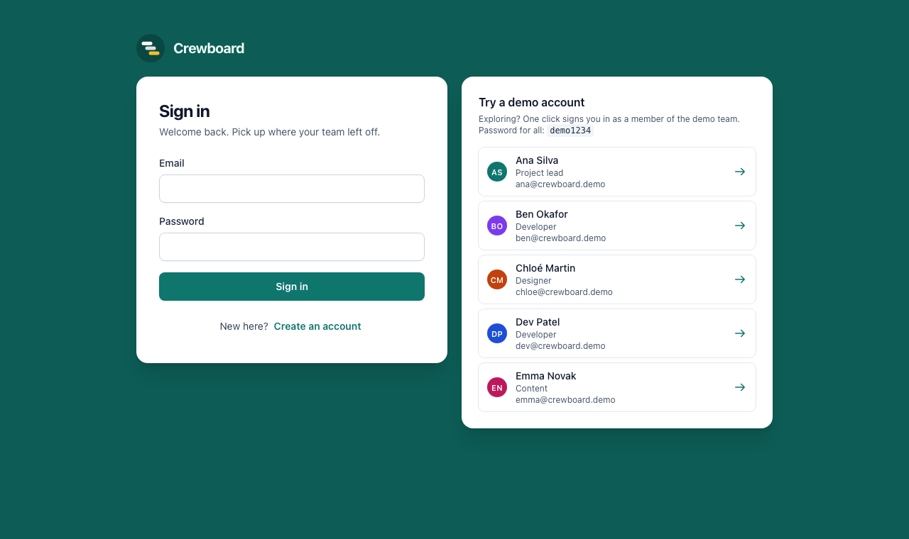
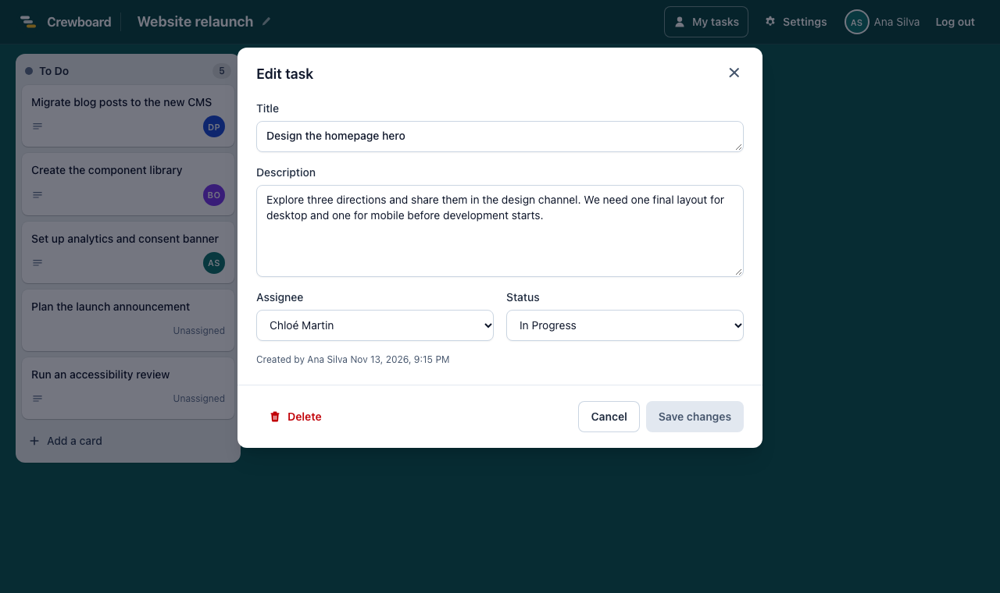
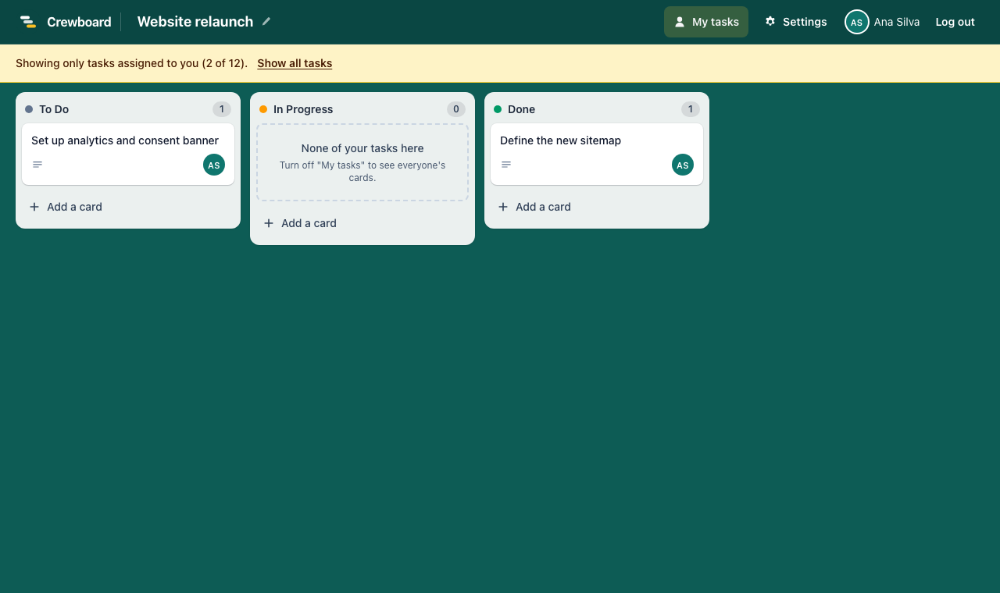
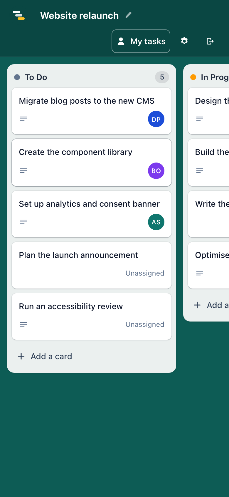

# Crewboard

A minimal Kanban board for a small team: three columns, cards you can drag between them, assignees, and a "My tasks" filter. It runs entirely in the browser, with a REST-shaped API layer that is mocked locally, so the demo works without any server.

**Live demo:** https://vlvereta.github.io/team-task-board/



## The brief

A remote team of five wanted a minimal task board to find out whether a structured workflow helps them: sign in, see one shared board with To Do / In Progress / Done, create and assign tasks, drag them between columns, and filter to their own work. The original brief asked for React on the front end and a Node.js API.

This portfolio version keeps the full front end and the API contract, but replaces the server with an in-browser mock so the demo can be hosted for free on GitHub Pages. The UI talks to the API only through a transport interface, so pointing it at a real Express server is a one-line change (see below).

## Demo accounts

Every demo account uses the password **`demo1234`**. The login page also has one-click buttons for each.

| Name         | Email                | Role         |
| ------------ | -------------------- | ------------ |
| Ana Silva    | ana@crewboard.demo   | Project lead |
| Ben Okafor   | ben@crewboard.demo   | Developer    |
| Chloé Martin | chloe@crewboard.demo | Designer     |
| Dev Patel    | dev@crewboard.demo   | Developer    |
| Emma Novak   | emma@crewboard.demo  | Content      |

You can also sign up with any email. Data lives in your browser's `localStorage`; **Settings → Reset demo data** restores the original board.

## Features

- **Accounts:** sign up (with validation and a clear duplicate-email message), log in, log out; the session survives reloads and expires after 12 hours.
- **Board:** one board with To Do, In Progress and Done, live task counts, an empty state per column, and a rename-in-place board title.
- **Tasks:** create from any column with title, description and assignee; open a card to edit any field or change its status; delete with confirmation. Each task has its own deep link (`#/board/tasks/<id>`).
- **Drag and drop:** move cards between columns and reorder within a column with mouse, touch (press and hold) or keyboard (Space, arrow keys, Space). Updates are optimistic and roll back with a visible message if the API call fails.
- **My tasks:** one toggle shows only your tasks; column counts follow the filter and a banner makes it easy to clear. The filter is kept in the URL.
- **Settings:** change your display name, rename the board, reset the demo data.
- **Quality:** responsive from 320 px (columns snap-scroll horizontally, dialogs become full-screen sheets), rem-based sizing that holds up at 200% text and 400% zoom, 44 px touch targets on touch devices, keyboard access with visible focus, focus-trapped dialogs, reduced-motion support, no console errors.

## Screenshots

| Login                                | Task dialog                                      |
| ------------------------------------ | ------------------------------------------------ |
|  |  |

| My tasks filter                                    | Phone                                       |
| -------------------------------------------------- | ------------------------------------------- |
|  |  |

## Architecture

Three layers with one-way dependencies. The UI never touches stored domain data; only the mock server does.

```
┌──────────────────────────────────────────────────────────┐
│ UI  (src/pages, src/components, src/app/*Context)        │
│   React + React Router (hash routing) + Tailwind         │
│   knows only the typed API client                        │
└───────────────┬──────────────────────────────────────────┘
                │ api.tasks.move(id, { status, position })
┌───────────────▼──────────────────────────────────────────┐
│ API client  (src/api/client.ts)                          │
│   builds { method, path, headers: Authorization, body }  │
│   turns error bodies into ApiError, 401 → back to login  │
└───────────────┬──────────────────────────────────────────┘
                │ Transport.send(request) → { status, body }
┌───────────────▼──────────────────────────────────────────┐
│ Mock server  (src/mock) ← this build                     │
│   router · token check · validation · versioned store    │
│   150–400 ms latency · persists to localStorage          │
│ ─ or ─ createFetchTransport(url) → a real REST server    │
└──────────────────────────────────────────────────────────┘
```

- **`src/api/`** holds the domain types, the `Transport` interface, the typed client and `ApiError`. The REST contract (endpoints, shapes, error format, status codes 400/401/403/404/409) is documented in [`docs/API.md`](docs/API.md).
- **`src/mock/`** is a small REST server that runs in the page: route matching, bearer-token auth, input validation, a store with a schema version, the seed data, and the artificial latency.
- **`src/app/`** wires things together. `composition.ts` is the only file that picks the transport. `BoardDataContext` loads the board, users and tasks, queues mutations so they reach the server in order, and applies drag-and-drop moves optimistically with rollback.
- **State management** is plain React state and context; no extra library was needed.

### Swapping the mock for a real API

Open `src/app/composition.ts` and replace the mock transport:

```ts
import { createFetchTransport } from '../api/transport';

const transport = createFetchTransport(import.meta.env.VITE_API_URL);
```

Nothing in the UI changes. A real server (for example Express with MongoDB, as in the original brief) needs to implement the endpoints in [`docs/API.md`](docs/API.md), return the same JSON shapes and error format, and accept `Authorization: Bearer <token>`.

### About the simulated authentication

**This is a client-side simulation for demo purposes, not real security.** Passwords are salted and hashed with PBKDF2 (Web Crypto) before they are stored, and the session token is a signed, expiring JWT-shaped string, but everything (the user records, the signing secret and the code that checks them) lives in your own browser. Anyone with access to the browser can read or change it.

A real backend would keep the user store and signing secret on the server, hash passwords with a slow algorithm such as Argon2 or bcrypt, issue tokens over HTTPS (ideally in an `HttpOnly`, `Secure` cookie), check every request server-side, rate-limit login attempts, and support password reset and revocation.

## Local setup

Requires Node.js 24 or later.

```bash
npm install
npm run dev          # http://localhost:5173/team-task-board/
```

| Script                 | What it does                                                              |
| ---------------------- | ------------------------------------------------------------------------- |
| `npm run dev`          | Start the Vite dev server                                                 |
| `npm run build`        | Type-check and build to `dist/`                                           |
| `npm run preview`      | Serve the production build                                                |
| `npm run lint`         | ESLint, zero warnings allowed                                             |
| `npm run typecheck`    | `tsc` in strict mode                                                      |
| `npm test`             | Unit and component tests (Vitest, React Testing Library)                  |
| `npm run test:e2e`     | End-to-end tests (Playwright) against the production preview build        |
| `npm run usage-report` | Recompute the build's token usage from local Claude Code logs (see below) |

The mock API's delay can be changed with `VITE_MOCK_LATENCY="min,max"` (milliseconds). Adding `?failMoves=1` before the `#` in the URL makes every drag-and-drop save fail, to see the rollback.

## Testing

- **Unit and component tests** cover every mock-server endpoint, including error paths (validation, 401 for missing, malformed and expired tokens, 403, 404, 409), the seed, password hashing, the move/position logic, the optimistic-update rollback, and dialog focus handling.
- **End-to-end tests** (Playwright, Chromium) run against the production build: sign-up, login and logout, route guards, task create/edit/delete, drag between columns, reorder, keyboard moves, rollback, persistence after reload, the My tasks filter, settings and demo reset, deep links, a phone-sized run, and layout checks at 320, 768 and 1440 px, at 200% text size and with very long titles. Every e2e test fails on any console error or warning.

## CI and deployment

- `.github/workflows/ci.yml` runs on pull requests and pushes to `main`: install, lint, typecheck, unit tests, build, Playwright. The Playwright report is uploaded when it fails.
- `.github/workflows/deploy.yml` runs on pushes to `main` (and manually): it runs the same checks, then builds and publishes `dist/` with the official GitHub Pages actions. Anything merged to `main` goes live without manual steps.

## How this was built

This project was built by an AI coding agent (Claude Code) from a written spec, under the owner's direction. The owner wrote the spec and the build instructions; the agent planned, implemented, tested, deployed, reviewed and measured the work in one session, using Claude Opus for planning, integration and review decisions and the cheaper Claude Sonnet for delegated, well-specified parts (the mock server and its tests, the Playwright suite, the independent reviews).

<!-- BUILD-NUMBERS:START -->

| Iteration 1         |                                                                                                                                     |
| ------------------- | ----------------------------------------------------------------------------------------------------------------------------------- |
| Time                | 3 h 55 min active (5 h 48 min wall-clock, including a 1 h 53 min pause at a usage limit); live 28 minutes after the first prompt    |
| Tokens              | 112.7 million in total (0.86 million output; most of the rest is cache reads)                                                       |
| API-equivalent cost | US$39.07 at Anthropic list prices (Opus 5.5 $25.05, Sonnet 5.5 $14.02)                                                              |
| Models              | Claude Opus 5.5 (main session), Claude Sonnet 5.5 (13 subagents: mock server, Playwright suite, independent reviews)                |
| Reviews             | 7 independent functional and 3 design review rounds on the live site; every functional issue found was fixed with a regression test |

The final review round was stopped at the owner's request after round 5's fixes were deployed; see the report for what that means.
<!-- BUILD-NUMBERS:END -->

The full breakdown, method and caveats are in [`docs/BUILD-REPORT.md`](docs/BUILD-REPORT.md). Design and scope decisions are logged in [`docs/DECISIONS.md`](docs/DECISIONS.md).

## Licence

[MIT](LICENSE)
